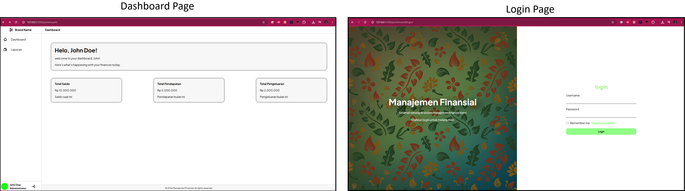

# 🎨 Tugas Pertemuan 4: Menyusun Front-end

Proyek ini merupakan tugas pengembangan **Front-end Web** menggunakan **HTML5** dan **CSS3**. Pada pertemuan ini, dilakukan penyusunan tampilan antarmuka website dengan memperhatikan struktur halaman, pengaturan layout, pemilihan warna, serta penggunaan styling agar tampilan lebih menarik dan nyaman digunakan.

---

## 📸 Preview Hasil (Screenshot)

Berikut adalah visual dari halaman website yang telah dibuat:

<!-- Simpan screenshot hasil pengerjaan di folder pertemuan4 dengan nama 'preview.png' -->
<p align="center">
  
</p>

---

## ✨ Fitur & Detail Desain

### 1. Struktur Halaman (HTML5)

- **Struktur HTML:** Menggunakan elemen HTML untuk menyusun konten dan komponen halaman website.
- **Pemisahan Halaman:** Memiliki beberapa halaman, termasuk halaman utama dan halaman login.
- **Pengelolaan File:** Menyusun file HTML ke dalam folder agar struktur proyek lebih terorganisasi.
- **Penggunaan Assets:** Memanfaatkan file pendukung seperti CSS dan gambar untuk membangun tampilan website.

### 2. Styling dan Tampilan (CSS3)

- **Custom Styling:** Menggunakan CSS untuk mengatur warna, ukuran teks, jarak, dan tampilan elemen.
- **Layout Halaman:** Menata posisi elemen agar halaman terlihat rapi dan mudah dipahami.
- **Penggunaan Background:** Memanfaatkan aset grafis sebagai pendukung tampilan halaman.
- **External Stylesheet:** Menggunakan file CSS eksternal agar styling lebih mudah dikelola.

### 3. Pengelolaan Assets

- **CSS:** File `style.css` digunakan untuk mengatur tampilan halaman.
- **Image Assets:** File `bg.svg` digunakan sebagai aset grafis pendukung.
- **Struktur Folder:** File HTML, CSS, dan gambar disusun dalam direktori terpisah agar lebih terorganisasi.

---

## 🗂️ Struktur File

```text
pertemuan4/
├── assets/
│   ├── css/
│   │   └── style.css
│   └── img/
│       └── bg.svg
├── login/
│   └── index.html
├── index.html
└── README.md
```

---

## 💻 Cara Menjalankan

1. Buka folder `pertemuan4` di Visual Studio Code.
2. Buka file `index.html` menggunakan browser atau ekstensi Live Server.
3. Untuk melihat halaman login, buka file `login/index.html`.
4. Pastikan file CSS dan aset gambar berada di lokasi yang sesuai agar tampilan website berjalan dengan benar.
5. Lakukan perubahan pada HTML dan CSS sesuai kebutuhan pengembangan front-end.

---

## 🛠️ Teknologi yang Digunakan

- **HTML5** — untuk menyusun struktur halaman website.
- **CSS3** — untuk mengatur layout, warna, dan tampilan visual.
- **SVG** — sebagai format aset grafis.
- **Visual Studio Code** — sebagai editor kode untuk pengembangan proyek.

---

## 👨‍💻 Kesimpulan

Melalui tugas Pertemuan 4 ini, dilakukan praktik penyusunan antarmuka website menggunakan HTML dan CSS. Proyek ini membantu memahami struktur halaman, pengelolaan aset, penggunaan stylesheet eksternal, serta pengorganisasian file dalam pengembangan front-end web.