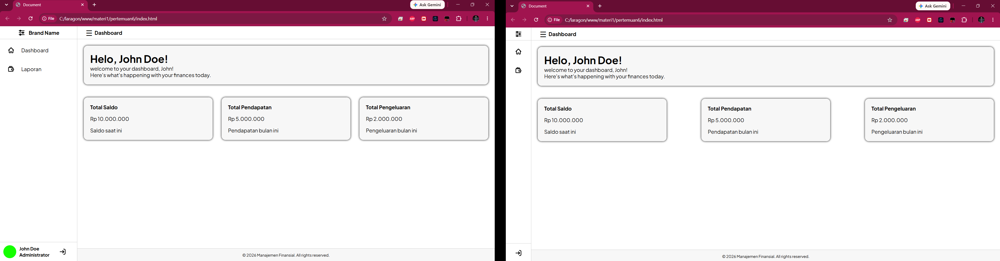

# Pertemuan 6 - Sidebar Collapse

Pertemuan ini berfokus pada penambahan fitur **sidebar collapse** pada dashboard di `index.html`. Sidebar dapat diciutkan untuk memberi ruang lebih luas pada area utama, lalu dibuka kembali melalui tombol ☰.

## Preview

Gambar berikut memperlihatkan dashboard dengan sidebar terbuka dan diciutkan:

## Penjelasan kode

- Tombol ☰ dengan ID `btn-toggle-sidebar` menjadi pemicu untuk mengubah tampilan sidebar.
- Saat halaman dimuat, JavaScript membaca nilai `statusSidebar` dari `localStorage`. Jika nilainya `sempit`, kelas `sidebar-collapsed` dipasang pada `<body>`.
- Saat tombol ☰ diklik, JavaScript mengubah kelas `sidebar-collapsed`. CSS pada `assets/css/style.css` menggunakan kelas ini untuk mempersempit sidebar dan menyembunyikan teks serta informasi profil.
- Setelah perubahan, kondisi sidebar disimpan kembali di `localStorage` sebagai `sempit` atau `lebar`, sehingga pilihan terakhir tetap digunakan saat halaman dibuka kembali di browser yang sama.

Perubahan fitur interaktif berada pada JavaScript di `index.html`; aturan tampilannya menggunakan CSS sidebar collapse yang tersedia di `assets/css/style.css`.

## Cara menjalankan

Tidak diperlukan instalasi dependency atau proses build.

1. Buka `index.html` di browser, atau jalankan folder `pertemuan6` melalui server web lokal.
2. Klik tombol ☰ di bagian atas untuk menciutkan atau membuka kembali sidebar.
3. Muat ulang halaman untuk melihat bahwa kondisi terakhir tersimpan di browser.

Dokumentasi ini hanya mencakup fitur sidebar collapse pada dashboard. Halaman login dan halaman uji layout tidak termasuk dalam pembahasan.
